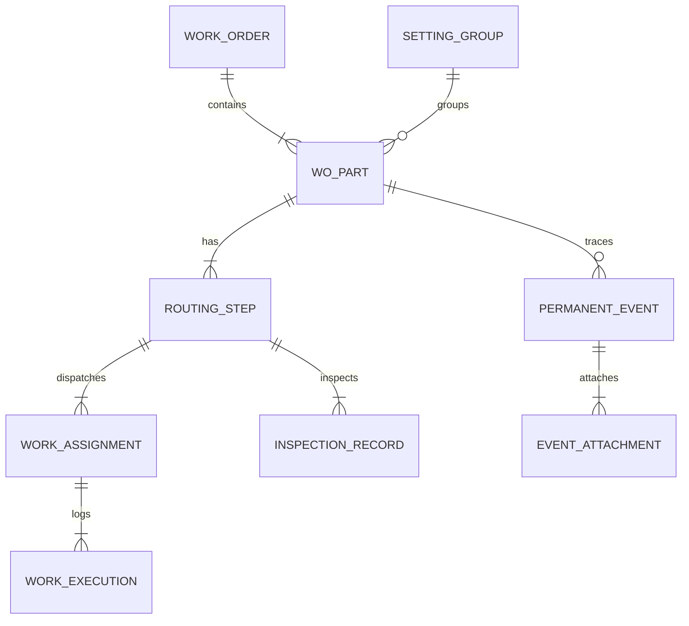

# ARCHITECTURE: CNC 통합 가공관리 시스템 (MES v1.0.0)

**작성 일시:** 2026-10-26  
**시스템 명칭:** CNC Integrated Machining Execution System (CNC-MES)  
**기반 기술:** C# ASP.NET Core 8.0, SQLite WAL, SignalR Realtime Hub, Three.js Backplot, Vanilla JS/CSS

---

## 1. 시스템 구성도

```
 [사내 LAN 폐쇄망 (인터넷 불필요, 포트 5000)]
  │
  ├── [중앙 서버 PC (관리자 PC 겸용)]
  │     ├── CNC-MES Core Server (.NET 8.0 Kestrel)
  │     ├── SQLite DB (WAL Mode, High Concurrency)
  │     ├── SignalR Realtime Hub (상태/알림/채팅 브로드캐스트)
  │     ├── File Storage (/data/uploads, /data/nc_files)
  │     └── FOCAS 장비 데이터 취합 에이전트
  │
  ├── [작업자 단말기 PC (현장 각 PC / 태블릿)]
  │     └── 브라우저 기반 작업자 전용 UI (간편 터치/3-클릭 인터페이스)
  │
  ├── [관리자 PC 대시보드]
  │     └── 브라우저 기반 종합 관제 대시보드 (7대 장비, 진척률, 품질, 납기)
  │
  └── [CNC 가공 장비군 (총 7대)]
        ├── FANUC RoboDrill 5대 (이더넷 FOCAS 통신 / 장비 상태, 프로그램, 가동시간)
        └── Roku-Roku 2대 (네트워크/수동 수집 및 바코드/상태 모니터링)
```

---

## 2. 핵심 데이터 모델 구조



### 2.1 테이블 명세 요약

1. **`work_orders` (작업지시서)**
   - `order_id` (PK), `order_number`, `customer_name`, `target_delivery_date`, `status`, `notes`, `created_at`
2. **`wo_parts` (부품 작업 항목)**
   - `part_id` (PK), `order_id` (FK), `part_code`, `part_name`, `material`, `thickness`, `target_qty`, `production_type` (단품/양산), `setting_group_id` (FK), `current_step_id`, `status`
3. **`routing_steps` (공정 단계)**
   - `step_id` (PK), `part_id` (FK), `step_sequence`, `step_name` (예: 1차가공, 2차가공), `target_machine`, `nc_program_name`, `nc_program_version`, `status` (대기/가공중/측정대기/완료)
4. **`work_assignments` (작업 배정)**
   - `assignment_id` (PK), `step_id` (FK), `machine_id`, `worker_username`, `assigned_qty`, `status`
5. **`work_executions` (실제 가공 실행 기록 - 고유 ID 보존)**
   - `execution_id` (PK), `step_id` (FK), `assignment_id` (FK), `machine_id`, `worker_username`, `start_time`, `end_time`, `machined_qty`, `status` (가공중/일시중지/가공완료)
6. **`inspection_records` (공정별 측정 기록 - 절대 필수)**
   - `inspection_id` (PK), `step_id` (FK), `part_id` (FK), `lot_id`, `inspector_username`, `inspected_at`, `inspection_type` (전수/샘플), `inspected_qty`, `passed_qty`, `failed_qty`, `rework_qty`, `dimension_data_json`, `result_verdict` (합격/불합격/보류), `notes`
7. **`setting_groups` (세팅 그룹)**
   - `group_id` (PK), `group_name`, `material`, `fixture_type`, `origin_point`, `shared_tools_json`
8. **`permanent_events` (영구 이벤트 히스토리 - 핵심 기능)**
   - `event_id` (PK), `part_code`, `part_id`, `order_id`, `step_id`, `machine_id`, `event_category` (가공중/가공후/납품후/사용중), `event_type` (공구파손/치수불량/설계변경/조립간섭/마모 등), `description`, `cause`, `action_taken`, `before_state`, `after_state`, `status` (접수/진행/검증대기/종결), `author_username`, `created_at`
9. **`event_attachments` (이벤트 사진 및 첨부파일)**
   - `attachment_id` (PK), `event_id` (FK), `file_type` (IMAGE/PDF/EXCEL/NC), `original_filename`, `stored_filename`, `file_size`, `annotations_json`, `uploaded_at`
10. **`handover_logs` (인수인계)**
    - `handover_id` (PK), `sender_username`, `receiver_username`, `machine_id`, `summary`, `pending_issues`, `confirmed_at`
11. **`topics_and_messages` (Zulip형 토픽 기반 채팅)**
    - `channel_type` (ORDER/PART/MACHINE/GENERAL), `topic_key`, `author`, `content`, `created_at`

---

## 3. 핵심 아키텍처 원칙

1. **작업지시서와 실제 가공 실행의 완전한 분리**
   - 하나의 부품을 여러 장비(R01, R02, K01)에서 분할 가공하더라도 각 장비별 고유 `execution_id`로 실적이 생성되며, 부품 실적에 안전하게 합산됨.
2. **공정 완료와 검사 완료의 분리 (측정 필수 게이트웨이)**
   - 가공 완료 시 자동으로 공정 완료가 되지 않으며 반드시 `측정대기(WAITING_INSPECTION)` 상태로 전이.
   - 측정 합격 판정 시에만 다음 공정으로 투입 가능 수량 전달.
3. **영구 이벤트 보존 및 재제작 시 과거 이력 선제 경고**
   - 동일 품번(`part_code`)으로 신규 작업 등록 시, 과거의 모든 공구 파손, 치수 불량, 설계 변경, 납품 후 클레임 이력을 작업자에게 즉시 팝업 알림.
4. **작업자 3-클릭 최소화 UI**
   - 작업자는 로그인 후 [내 장비 선택] -> [작업 시작] -> [가공 완료 / 불량 등록] 단 3단계로 핵심 업무 완료.
